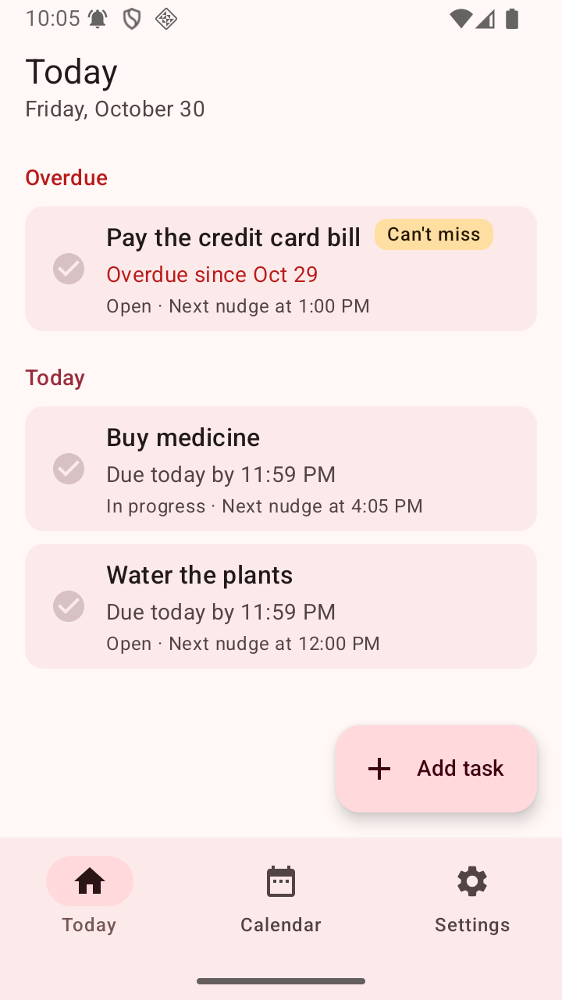
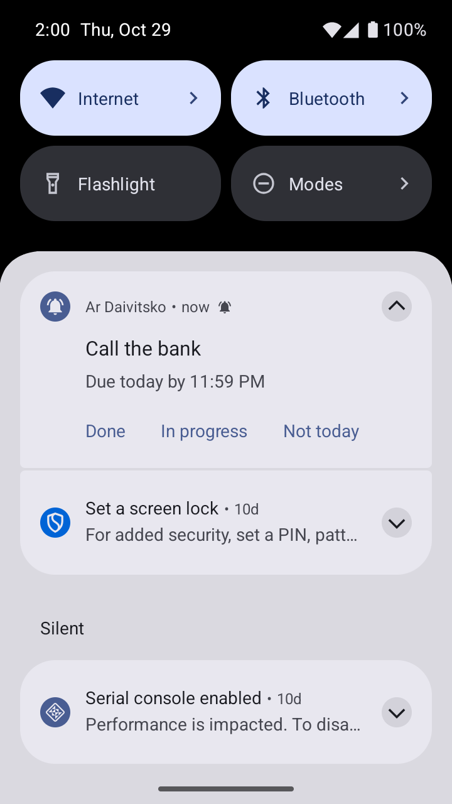
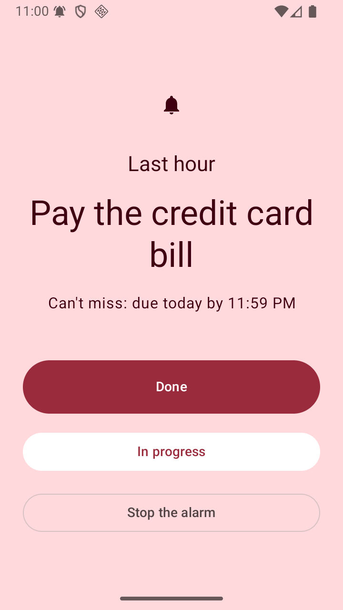
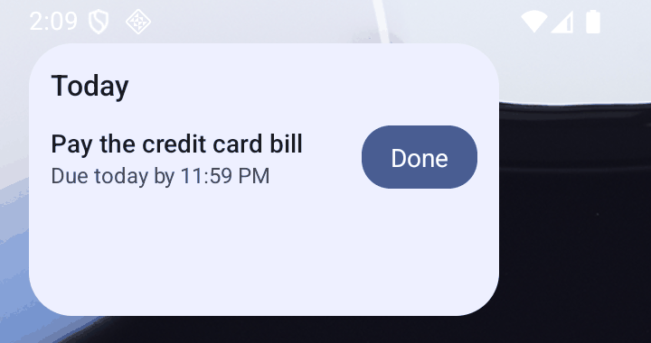
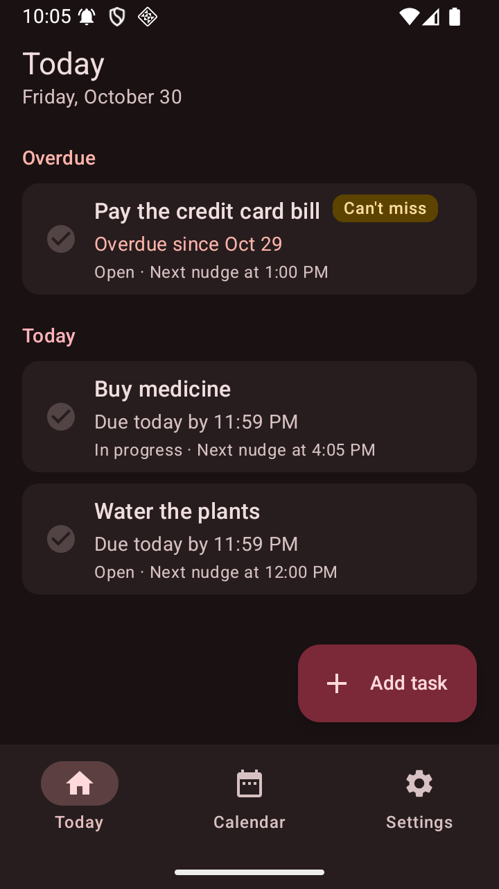
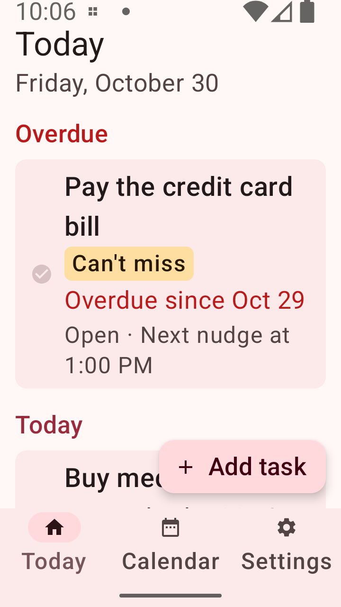
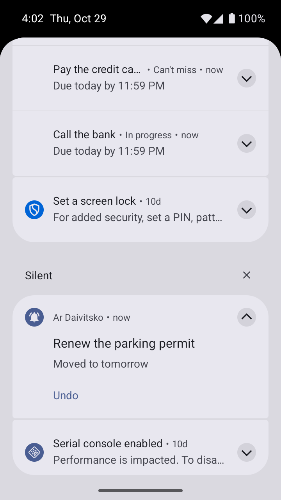
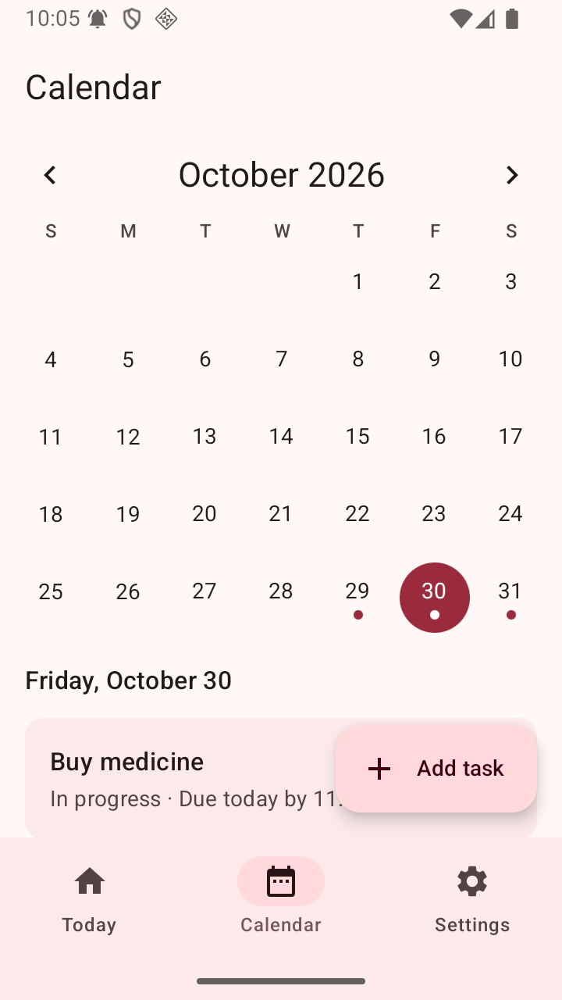
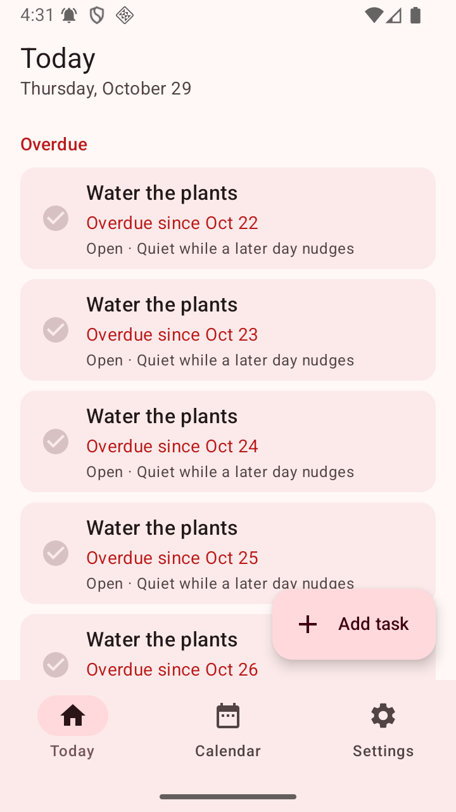
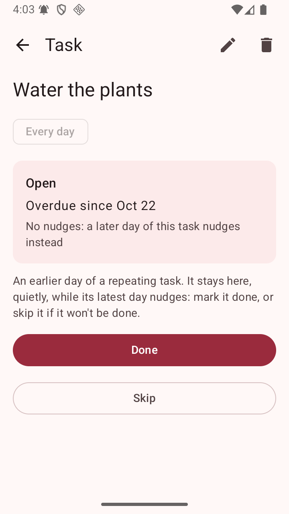

# Ar Daivitsko for Android

The Android app: native Kotlin, Jetpack Compose and Material 3. It follows
[docs/behaviour.md](../docs/behaviour.md) to the minute; the iOS app in [`ios/`](../ios) follows
the same document with no shared code.

| Today | A nudge | The alarm | Widget |
| --- | --- | --- | --- |
|  |  |  |  |

| Dark | Text at 2x | Not today, with Undo | Calendar |
| --- | --- | --- | --- |
|  |  |  |  |

| Quiet earlier days | A quiet day: Done or Skip |
| --- | --- |
|  |  |

## Building and testing

Toolchain, as in the rest of the fleet: AGP 9.4.1, Kotlin 2.4.21, KSP 2.3.11, Gradle 9.8.1,
Compose BOM 2026.09.00, Room 2.8.5, JDK 17 or later (the Android Studio JBR works), compileSdk and
targetSdk 37, minSdk 26.

```sh
cd android
./gradlew :app:installDebug                       # on a connected phone or emulator
./gradlew :core:test :app:testDebugUnitTest       # every JVM test (148)
./gradlew :app:lintDebug                          # lint; a warning fails the build
./gradlew :app:connectedDebugAndroidTest          # Room, notification and Compose tests (19)
./gradlew :app:assembleRelease                    # minified with R8, unsigned
```

`connectedDebugAndroidTest` starts the app with an in-memory database (`TestRunner`), so it never
touches the tasks on the phone. It does uninstall the app when it finishes, as Gradle always does.

## Architecture

Two modules:

- **`:core`**, plain Kotlin with no Android SDK on its classpath: the rules of the app.
  - `NudgePlanner`: the nudge planner, a pure function. Given an occurrence (the task's timing,
    its state, and the anchors In progress and Snooze leave), the settings and a time zone, it
    returns every nudge with its time and kind: regular, overdue, heads-up, final, alarm or
    deadline passed. `plan()` lists them through a date, `next()` finds the next one, and
    `between()` finds the ones in a time range.
  - `deliver()`: what to post now and when the next alarm should go off. When nudges were
    missed, it posts one catch-up per occurrence, never one per missed time.
  - `OneNudgePerTask`: a repeating task nudges only for its latest day so far. Its earlier open
    days stay listed as overdue, quietly, until they're done or skipped. Days count as the series
    gave them, not where a move put them.
  - `Answers` (Done, In progress, Snooze, Not today, Move to, Undo, Skip, Reopen), `Repeats` (monthly
    from the 31st clamps to the month's end), and `NudgeTexts` ("Due today by 23:59", "Overdue
    since 28 Oct", "Last 30 minutes").
- **`:app`**, everything Android, wired by hand in `AppContainer` (no DI framework):
  - `data/`: Room keeps a task row, and one occurrence row per day it falls on, with its state,
    anchors and last nudge. A unique key on (task, original day) stops a day from getting two
    rows. Rows are written out a day ahead (tomorrow's, for the heads-up); later repeats are
    worked out from the task's rule when the calendar needs them. Settings live in a Preferences
    DataStore. The schema is exported to `app/schemas`.
  - `nudge/NudgeService`: the one place that changes what's scheduled, one change at a time.
    `reconcile()` writes out the coming days, posts each occurrence's due nudge, and sets one
    exact alarm per occurrence for its next nudge. It leaves a task's earlier open days quiet:
    no nudge, no alarm, no catch-up, and any notification still showing goes. It runs after
    every alarm, answer and edit; at
    midnight (an alarm of its own); on `BOOT_COMPLETED`, `TIME_SET`, `TIMEZONE_CHANGED`,
    `MY_PACKAGE_REPLACED` and when exact alarms are allowed; and whenever the app opens.
  - Alarms: `setExactAndAllowWhileIdle` for nudges, and `setAlarmClock` for the Can't-miss alarm.
    Each alarm's action names its occurrence (`…action.NUDGE/12`), so `adb shell dumpsys alarm`
    shows whose it is. Without the exact alarm permission they fall back to inexact alarms, and
    Settings says so.
  - Notifications: one per occurrence. Each new nudge updates it in place, so it alerts again.
    It shows the title, why now, and Done, In progress and Not today. A `BroadcastReceiver`
    handles the buttons with `goAsync()` and a coroutine. Not today posts "Moved to tomorrow"
    with Undo. On a Can't-miss task's last day, its button opens the app to confirm. Tapping the
    notification opens the task, with Snooze 1 hour and Move to…. There are four channels:
    nudges, Can't-miss alarms (alarm sound, full screen), heads-ups, and moved tasks (quiet).
  - The alarm is its own notification, on the alarm channel, with a full-screen intent and a
    sound that repeats until it's answered (`FLAG_INSISTENT`). It opens `AlarmActivity` over the
    lock screen.
  - Screens (`ui/`): Today, Calendar, Add or edit, the task, and Settings. On Today, a quiet
    earlier day reads "Quiet while a later day nudges"; opened, it offers only Done and Skip.
    Skipped days leave Today and the widget, and count as answered for the calendar's mark.
    Each ViewModel exposes
    StateFlow and is made with `viewModel { }` initializers from the container; navigation uses
    type-safe routes. Times follow the phone's 12/24-hour setting, read again on every resume.
    The add/edit form is kept in the `SavedStateHandle`, so it survives process death.
  - `widget/`: a Glance widget lists today's open tasks, overdue first, each with Done. Its
    rows are read inside the composition, keyed on a version every change bumps: Glance
    recomposes an open session rather than calling `provideGlance` again. WorkManager 2.12.0 is
    declared because Glance's own version crashes a minified build at launch.

### Choices where docs/behaviour.md is silent

These were agreed with Merab and the iOS app, and are written into docs/behaviour.md on `main`:

- Quiet hours never silence the Can't-miss extras (heads-up, final hours, alarm, deadline
  passed).
- A snooze in the final hours holds back the slots before its nudge, but never the alarm. Its
  own nudge counts as a final one.
- The heads-up has no Not today, since the task isn't for today yet.
- Cadences, the three hours before the deadline, and the last hour all count on the wall clock.
  A snooze late at night still nudges after midnight, and the new day keeps its grid.
  Example 11: a deadline just after the spring gap gets its alarm on the last slot before it.
- One nudge per task (Merab's ruling, worked examples 12 and 13): only a repeating task's
  latest day so far nudges. When today isn't one of its days, that's the most recent one. Its
  earlier open days are quiet, and can be marked Done or Skipped. Days count as the series
  gave them: after Not today, today's occurrence is still the latest, so an older open day
  doesn't wake up; the next day of the series takes over.
- Editing a one-off task's day moves its one occurrence there and keeps its state. An overdue
  one becomes due on the new day, and Done stays Done.
- After the deadline, regular nudges carry on until the day ends.
- Nudges due at the same instant come as one: the stronger kind wins.

Smaller choices of this app, beyond the spec:

- A repeating task whose first day is in the past gets that first day (overdue) and then the
  days from the day it was created, not every day in between. Editing a task's day or repeat
  re-plans from today: days nobody has answered make way, answered ones stay.
- A one-off task's day follows its occurrence when it moves, so editing it shows where it is.
  An occurrence that Not today had moved becomes Open when its day is edited, since the day is
  now the one chosen.
- An answer counts as the last nudge, so nothing before it fires as a catch-up. The same goes
  for an edit or a change of quiet hours. A clock turned back starts again from the new time.
- In the app, Snooze is offered for a task due today or overdue. "Mark as not done" reopens a
  Done task. The alarm screen also has "Stop the alarm", which silences it and leaves the task
  in the shade.

## What was checked on the Fleet_API36 emulator (Android 16, API 36)

I added tasks through the app as a user would, and moved the clock with
`cmd alarm set-time` (automatic time off, restored afterwards):

- **Nudges and their buttons:** an hourly task nudged at 14:00 with Done, In progress and Not
  today. The notification was on the nudges channel at high importance.
- **In progress halves the rate:** tapped at 14:00:47, its next alarm in `dumpsys alarm` moved
  to 16:00:47, twice its interval.
- **Not today, with Undo:** the nudge became "Moved to tomorrow" with Undo, and the alarm moved
  to the next day at 10:00. Undo brought it back to 19:00 today, with no catch-up.
- **Done stops it:** after Done on a notification, its alarm shows only under "Removal history"
  in `dumpsys alarm`, and the app's uid holds alarms only for the other tasks.
- **Can't miss:** the nudge at 19:00, "Last 3 hours" at 21:00, a catch-up of the 22:30 slot
  ("Last 1½ hours") after a jump, then 23:00 as the system's next alarm clock. With the screen
  off, the alarm woke the screen to the full-screen alarm over the lock screen, with the alarm
  sound and vibration playing. That held with the 22:30 nudge still in the shade, and with
  another task's nudge due at the same instant. Stop the alarm silenced it. "Deadline passed"
  came at 23:59.
- **Overdue carry-over:** the next morning both open tasks read "Overdue since Oct 29", Today
  listed them under Overdue, and the midnight tick had moved on to the next day.
- **Reliability:**
  - An app update (`adb install -r`) started the reschedule receiver from
    `MY_PACKAGE_REPLACED`.
  - A time-zone change from Tbilisi to Tokyo moved the next nudge to 16:00 on Tokyo's clock,
    and back again.
  - Turning the clock back re-armed the 23:00 alarm.
  - A real guest reboot (`adb reboot`) brought every alarm back from `BOOT_COMPLETED`, before
    the app was opened.
- **The widget:** placed from the launcher's picker, which showed its preview. It listed the
  overdue tasks first, and its Done marked the task done, redrew the widget and removed the
  alarm.
- **One nudge per task:** a daily task added with the clock set a week back, then the clock
  returned to today. Only today's day posted its one catch-up, and the alarms were only today's
  next nudge and tomorrow's first. The seven earlier days were listed under Overdue as "Quiet
  while a later day nudges". Opened, one offered only Done and Skip. Skip took it off the list,
  and the calendar marked that day "all done" (hollow).
- **Notifications are asked for when the first task is added**, not at launch.
- **Looks:** light, dark and font scale 2.0 on every screen; times follow the phone's 12-hour
  setting.
- **The minified release build** (R8, signed with the debug key) launched, ran its screens and
  drew the widget, with nothing in the crash buffer. WorkManager resolves to 2.12.0.

Bugs these checks found, fixed in their own commits:

- Grouping nudges under a summary took a waiting nudge away when another was answered.
- Re-posting a nudge silenced it in Android 16's regrouping.
- A full-screen intent fires only for a new notification, so the alarm got a tag of its own.
- Android 15+ mutes later notifications in a burst, so the alarm is posted first.

### Not checked on a device

- A real phone. Only the API 36 emulator was used. Android 12 to 14 were not run, so neither
  was the permission flow for exact alarms on Android 12 (SCHEDULE_EXACT_ALARM, which the user
  can refuse).
- Snooze and Move to… were tested in ViewModel tests, not tapped on the emulator. The heads-up
  the evening before, daylight-saving days and monthly repeats were tested in JVM tests only.
- The generated widget preview for Android 15+: the picker showed the plain preview layout.
- Battery savers that kill apps on some phones. The app doesn't ask to be exempted from
  battery optimization.
- On Android 15+ the system softens notifications that arrive in a burst ("Muting recently
  noisy" in the log), so when several tasks nudge at the same moment, only the first may sound.
