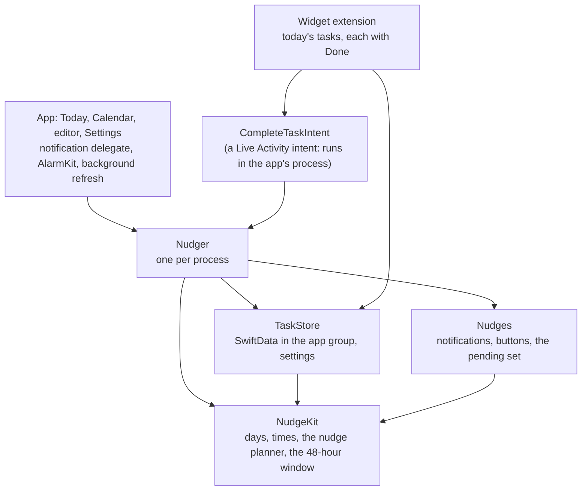

# Ar Daivitsko for iOS

**A reminder that keeps asking until you answer**, in Swift and SwiftUI. It behaves as
[docs/behaviour.md](../docs/behaviour.md) says: a task nudges on its day until you tap Done, In
progress, Not today or Snooze 1 hour, right on the notification. A Can't-miss task gets a
heads-up the evening before, a nudge every half hour in its last three hours, an alarm in the
last hour, and Deadline passed. Nothing unanswered disappears: it's overdue at the top of Today
until it's answered.

Native only: no code is shared with the Android app. Both follow the same behaviour document and
check its worked examples.

## Building and testing

Requires Xcode 26 (built with 26.6, iOS 26.5 SDK) and [XcodeGen](https://github.com/yonaskolb/XcodeGen).
The app runs on iOS 17 and later.

```sh
cd ios
xcodegen generate                     # writes ArDaivitsko.xcodeproj from project.yml (not committed)
open ArDaivitsko.xcodeproj            # run the ArDaivitsko scheme on a simulator or a phone
(cd ArDaivitskoKit && swift test)     # the shared package's tests, on the Mac (118 tests)
swift tools/render-icon.swift         # redraws the app icons
```

The UI tests run in the scheme's test action:

```sh
xcodebuild test -project ArDaivitsko.xcodeproj -scheme ArDaivitsko \
  -destination 'platform=iOS Simulator,name=iPhone 17'
```

Six more checks drive SpringBoard (banners, the widget, the alarm) and are skipped unless asked
for, since they depend on SpringBoard's layout and take minutes:

```sh
TEST_RUNNER_ARDAIVITSKO_SIMULATOR_CHECKS=1 TEST_RUNNER_ARDAIVITSKO_SHOTS=/tmp/shots \
  xcodebuild test ... -only-testing:ArDaivitskoUITests/SimulatorChecks
```

On a phone, the app and its widget extension need a team with the app group
`group.io.github.meko123456.ardaivitsko`, and the app needs the Time Sensitive Notifications
capability.

## Architecture



- **NudgeKit: when a task nudges, as a pure function.** `NudgePlanner.nudges(for:from:through:)`
  takes an occurrence (its task's rule, its state, and the moments that anchor its cadence:
  created, marked In progress, snoozed, moved), the quiet hours and a calendar, and returns every
  nudge with its kind: regular, overdue, heads-up, final, alarm, deadline passed. A `Day` is a
  calendar day with no time zone, a `TimeOfDay` a wall-clock time, and they become moments only
  with the phone's calendar: a skipped 02:30 becomes 03:30, a repeated 01:30 is the first, and
  cadences step on the wall clock. The module also holds repeats (monthly from the 31st clamps
  to each month's end), the agenda for Today, the calendar and the widget (including repeats not
  saved yet), the wording of each nudge, and the UI tests' seed format.
- **TaskStore: SwiftData in the app group.** A task and its occurrences are `@Model`s in a store
  the widget can read. A repeat saves its occurrences three days ahead, and fills in days the app
  missed, which are then overdue. Not today keeps what was there, for Undo. The settings and how
  far the last refresh scheduled live in the group's defaults.
- **Nudges: the notifications.** Four categories of buttons (below), requests with calendar
  triggers that have no time zone, so 10:00 stays 10:00 wherever the phone is, and a scheduler
  that keeps the pending set exactly the window.
- **Nudger: one per process.** The screens, the notification answers, the widget's intent and the
  alarm's Done all go through it. An answer saves, silences a sounding alarm, takes that
  occurrence's notifications off the screen, and refreshes. A refresh saves the occurrences
  repeats make, schedules the next 48 hours of nudges and alarms, catches up on missed nudges and
  redraws the widget. Refreshes run one at a time, in order. UserNotifications and AlarmKit sit
  behind protocols, so all of it is tested on the Mac.

### The 64-notification window

iOS keeps at most 64 pending notifications per app. The app schedules a rolling window: the next
48 hours across all tasks, at most 50, never splitting one moment's nudges. It fills the window
again at launch, when it comes forward, after every answer and change, on midnight or a time
change, and from Background App Refresh. Whatever the last refresh couldn't schedule, and the app
didn't run in time to, comes as **one catch-up per occurrence**, with the latest missed nudge's
text.

### Buttons on a nudge

| When | Buttons |
| --- | --- |
| A task's day, or overdue | Done, In progress, Not today, Snooze 1 hour (all without opening the app) |
| A Can't-miss task's last day | the same, but "Not today…" opens the app, which asks "This is the last day. Move it anyway?" |
| Before the task's day (the evening-before heads-up) | Done, In progress |
| "Moved to tomorrow" after Not today | Undo |

Every nudge is time sensitive, so a meeting's Focus doesn't swallow it, and all of one task's
nudges share a thread.

### The Can't-miss alarm

On iOS 26 the alarm is an AlarmKit alarm: full screen over the Lock Screen and in the Dynamic
Island, with Done beside slide to stop. Done runs the widget's intent. Permission is asked when the
first Can't-miss task is added. Before iOS 26, or with alarms refused, the alarm is a
time-sensitive notification. Each alarm's id comes from its occurrence and moment, so a refresh
recognises its own; one that's sounding is left alone until its task is answered.

### The widget

Today's unanswered tasks, overdue first, small, medium and large, each with a Done button. The
button is a Live Activity intent, which the system runs in the app's process even when the app is
closed, so it answers like any other answer: saved, notifications withdrawn, alarm silenced. The
occurrence is passed as a string id; an enum parameter arrived garbled from an ad-hoc signed
widget in Khinkali.

## Choices beyond docs/behaviour.md

Agreed with Merab while building, and being added to docs/behaviour.md; each has a test in
`PlannerEdgeTests` or `WorkedExampleTests`:

- Quiet hours never silence the Can't-miss extras (heads-up, final hours, alarm, Deadline passed).
- A snooze inside the final three hours skips the half-hour slots until tap + 1 h; the alarm and
  Deadline passed still come (example 8). The snooze nudge there isn't silenced by quiet hours.
- The alarm is the first slot in the last hour at or after the task's creation (example 9); when
  spring forward skips the whole last hour, it's the last slot before the deadline (example 11).
- In progress and Snooze step on the wall clock across daylight saving, the snooze's hour too.
  "Three hours before" and "the last hour" are wall-clock too, and skipped slots fold forward.
- A task's deadline only shows in the text unless it's Can't miss; regular nudges carry on after
  it until the day ends. Not today keeps the deadline's time.
- A daily task's unanswered yesterday and its today both nudge, grouped in one thread.
- Catch-up is one per occurrence. In progress tapped again restarts from the new tap. Not today on
  an overdue task moves it to tomorrow counted from today, and ends In progress.
- A snooze tapped late at night nudges once after midnight; the new day keeps its own grid.
- Two nudges of one task at one moment keep the strongest.

## Tests

- **Package (Swift Testing, 118, on the Mac):** every worked example in docs/behaviour.md
  (1 to 7) and the four agreed since (8 to 11), exactly. Daylight saving in New York both ways.
  Quiet hours across and inside a day. Intervals of 1, 2 and 4 hours. Snoozes in and around the
  final window. In progress on a Can't-miss task. Tasks created after their deadline. Repeats
  (monthly clamping, leap years, weekly). The 64-request window and catch-ups. The SwiftData store
  on an in-memory container, and on a file a second container reads, as the widget does. The
  notification categories, requests and scheduler against an in-memory center. The Nudger end to
  end: Done from a notification leaves nothing pending or shown for that task.
- **UI tests (XCUITest, 8):** add a task and a Can't-miss one; Done from the row and back; Done
  leaves no notifications pending for that task (Debug builds show the count in Settings); In
  progress; Not today with Undo, and the task found on tomorrow in the calendar; a Can't-miss
  task's last day asks before moving; overdue comes first. Each test seeds its tasks
  (ARDAIVITSKO_SEED, Debug builds only), answers the permission prompts, and launches the app
  once before the class.
- **Simulator checks (6, opt-in):** the four buttons on a banner, the widget's Done, a tapped
  nudge and the last-day question, the alarm over the Lock Screen, an answer silencing a sounding
  alarm, and screenshots of every screen.

## What was checked in the simulator

On an iPhone 17 simulator with iOS 26.5:

- **A nudge's banner over another app**, time sensitive, with Done, In progress, Not today and
  Snooze 1 hour when held open. Each button answered its task without opening the app, and Not
  today's confirmation carried an Undo that put the task back. This found a crash, fixed:
  the async form of the delegate's `didReceive` called the system's completion handler off the
  main thread.
- **Done leaves no pending notifications for its task**, while other tasks keep theirs, read from
  the real notification center.
- **Tapping a nudge opens its task.** On a Can't-miss task's last day, "Not today…" opens the
  app, which asks first.
- **The widget**, placed on the Home Screen: overdue first, and its Done took the task off the
  widget and marked it Done in the app, with nothing left pending.
- **The AlarmKit alarm**: the planned 23:00 alarm is scheduled with AlarmKit, and a test alarm
  built the same way sounded full screen over the Lock Screen, showing the task and its deadline.
  Answering the task in the app stopped it.
- **A catch-up on launch**, after a seeded gap in the window, and **12-hour times** with the
  phone set to 12-hour (11:59 PM in the app and in the notification).
- **Screens in light, dark and the largest text size (AX5).** This found the calendar's
  missing first week (colliding ids), now fixed. At AX5 the rows now stack, menus become
  lists, and the month grid stops growing while the day's list keeps full size.

Not checked, or not working, in the simulator:

- **The alarm's own Done.** AlarmKit's daemon runs the intent without its metadata, and linkd
  can't identify an ad-hoc signed app ("Unable to get teamId"), so the app finds no intent and
  nothing happens. A team-signed build on a phone should behave differently, but that's untested.
  Slide to stop works, and the final nudges and Deadline passed still come.
- **Background App Refresh.** The simulator keeps no app refresh requests; the debugger's
  simulated launch found none to run.
- A phone switched off at a nudge's time, a time zone change while closed, VoiceOver itself, and
  iPad. The design for each: iOS delivers the pending ones, with catch-up for the rest; the
  triggers are wall-clock; every button has a spoken label (checked in the accessibility tree);
  the screens are lists.
- iOS 17 to 25. Built for them, run only on 26.5.

## Known gaps

- Every unanswered day of a daily task nudges, as the spec says: a week ignored is a week of
  overdue occurrences nudging together, grouped in one thread. There's no "done for all" yet.
- No "Move to…" a chosen day; Not today moves to tomorrow, and the editor changes a task's day.
- English only.

## License

MIT, see [LICENSE](../LICENSE).
